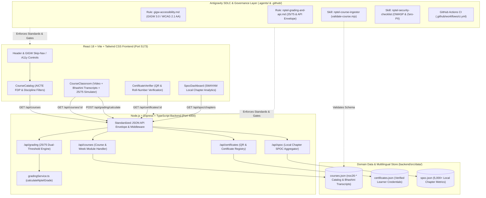
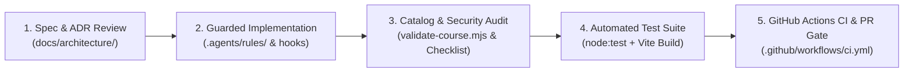

# NPTEL Online Certification Portal — System Architecture & Design

**Coordinating Institute:** IIT Madras (Indian Institute of Technology Madras)  
**Ministry:** Ministry of Education (MoE), Government of India  
**Semester Reference:** Jul–Nov 2026 (`noc26-*`)

---

## 1. Executive Overview

The **NPTEL Online Certification Portal** is a full-stack web platform engineered to deliver IIT/IISc video courses, multilingual Bhashini lecture transcripts, interactive weekly assignment grading calculators, verifiable QR-enabled digital certificates, and SWAYAM Local Chapter (SPOC) institutional analytics.

The repository is structured as a modular monorepo with an **Antigravity AI Governance Layer (`.agents/`)** enforcing domain invariants, accessibility standards (GIGW 3.0 & WCAG 2.1 AA), and OWASP API security rules across every stage of the Software Development Lifecycle (SDLC).

---

## 2. End-to-End System Architecture

---

## 3. Component Breakdown

### 3.1 Frontend Layer (`frontend/`)
- **Course Catalog (`CourseCatalog.tsx`)**: Searchable, filterable directory of IIT/IISc courses (`noc26-<discipline><number>`), displaying credit weightage, duration (4/8/12 weeks), AICTE FDP recognition badges, and enrollment counts.
- **Course Classroom & Bhashini Transcript Layer (`CourseClassroom.tsx`)**: Synchronized lecture viewer offering regional language transcripts (`en` English, `hi` Hindi, `ta` Tamil) powered by Bhashini metadata, paired with an interactive NPTEL 25/75 score simulator.
- **QR Certificate Verifier (`CertificateVerifier.tsx`)**: Public verification portal validating learner certificate IDs (`NPTEL26...`), displaying assignment/exam score breakdowns, medal tiers (`Elite + Gold`, `Elite + Silver`, `Elite`, `Successfully Completed`), and tamper-evident QR metadata.
- **SPOC Analytics Dashboard (`SpocDashboard.tsx`)**: Institutional dashboard for Single Points of Contact (SPOCs) across SWAYAM Local Chapters, tracking college-level active enrollments, exam registrations, and medal distributions.

### 3.2 Backend Layer (`backend/`)
- **Grading Calculation Engine (`src/services/gradingService.ts`)**: Pure, deterministic TypeScript service implementing the official NPTEL certification formula (`calculateNptelGrade`).
- **REST API Routes (`src/routes/`)**:
  - `/api/courses`: Lists and filters courses; validates `:id` against `/^noc\d{2}-[a-z]{2}\d{2}$/i`.
  - `/api/grading`: Evaluates weekly assignment arrays and proctored exam scores against the dual qualifying criterion.
  - `/api/certificates`: Resolves certificate verification lookups without leaking sensitive learner PII.
  - `/api/spoc`: Serves aggregated Local Chapter performance statistics and CSV-ready institutional summaries.

### 3.3 Antigravity Governance Layer (`.agents/`)
- **Workspace Rules (`.agents/rules/`)**: Always-on architectural constraints for GIGW 3.0 accessibility and NPTEL API/grading fidelity.
- **Domain Skills (`.agents/skills/`)**:
  - `nptel-course-ingestor`: Schema validation script (`validate-course.mjs`) and workflow for onboarding new IIT/IISc courses.
  - `nptel-security-checklist`: OWASP API Top 10 audit playbook tailored for grading integrity, IDOR prevention, and zero-PII logging.
- **Edit Hooks (`.agents/hooks/`)**: Automated post-edit verification hooks ensuring catalog JSON modifications remain schema-compliant.

---

## 4. Functional & Non-Functional Requirements

### 4.1 Functional Requirements
1. **Course Nomenclature**: Every course identifier must match `^noc\d{2}-[a-z]{2}\d{2}$` (e.g., `noc26-cs01`, `noc26-ee14`, `noc26-hs08`).
2. **Official 25/75 Grading & Best-N Policy**:
   - **Assignment Component (25%)**: Average of the **Best 3** (4-week), **Best 6** (8-week), or **Best 8** (12-week) weekly assignment scores (each out of 100), scaled to 25 (`assignmentScoreOut25` / `assignmentScoreOutOf25`).
   - **Proctored Exam Component (75%)**: Proctored exam score (out of 100) scaled to 75 (`examScoreOut75` / `examScoreOutOf75`).
   - **Dual Qualifying Criterion**: Certificate eligibility requires **BOTH** `assignmentScoreOut25 >= 10.0` (40% of 25) **AND** `examScoreOut75 >= 30.0` (40% of 75).
   - **Badge Classification**:
     - `Total >= 90`: `Elite + Gold`
     - `Total >= 75`: `Elite + Silver`
     - `Total >= 60`: `Elite`
     - `Total >= 40`: `Successfully Completed`
     - Unqualified or `Total < 40`: `No Certificate`
3. **Multilingual Bhashini Support**: All lecture modules must preserve `en`, `hi`, and `ta` transcript keys for inclusive learning across India.

### 4.2 Non-Functional Requirements
1. **GIGW 3.0 & WCAG 2.1 AA Accessibility Compliance**:
   - Minimum `4.5:1` contrast ratio for body text and `3:1` for UI controls.
   - Explicit `<label htmlFor="...">` bindings on all search inputs and score calculators; `aria-label` or `aria-pressed` on icon/filter buttons.
   - Semantic `<progress>` elements for completion indicators and `aria-live="polite"` regions for dynamic grading announcements and filter counts.
   - Use of modern `:user-invalid` and `:user-valid` pseudo-classes instead of `:invalid` so untouched inputs are never flagged as errors on initial load.
   - Copyable text: `user-select: none` is strictly prohibited on transcripts, syllabi, and certificate records.
2. **Standardized API Envelope Contract**:
   - All `/api/*` endpoints return a consistent JSON envelope containing status metadata (`success` / `status`), `data` (or structured `error`), and `nptelMeta` / `meta` (`semester: "Jul-Nov 2026"`, `coordinatingInstitute: "IIT Madras"`, ISO-8601 `timestamp`, `version: "v1"`).
3. **Security & Zero-PII Logging**:
   - Strict input bounds checking (`0 <= score <= 100`, finite numeric arrays) to prevent `NaN`/`Infinity` injection or grade tampering.
   - Application and error logs must never log learner Aadhaar numbers, phone numbers, personal emails, or home addresses.
   - All timestamps and deadlines follow Indian Standard Time (`Asia/Kolkata`, UTC+05:30).

---

## 5. Software Development Lifecycle (SDLC) Workflow

1. **Architecture & Specification (`docs/architecture/`)**: Significant domain or API changes are recorded via Architecture Decision Records (see `ADR-001-grading-and-api-standards.md`).
2. **Rule-Guided Development (`.agents/rules/`)**: Engineers and AI agents develop features against workspace-enforced rules for GIGW 3.0 accessibility and NPTEL API standards.
3. **Automated Data & Security Verification (`.agents/skills/`)**:
   - Course catalog edits trigger `.agents/skills/nptel-course-ingestor/scripts/validate-course.mjs`.
   - API changes are audited against `.agents/skills/nptel-security-checklist/SKILL.md`.
4. **Unit & Integration Testing (`backend/test/`)**: Node's built-in test runner (`node:test`) validates boundary conditions of the 25/75 grading engine (e.g., `9.99/25` vs `10.00/25`, `29.99/75` vs `30.00/75`) and REST API contracts.
5. **Continuous Integration & Pull Request Governance (`.github/`)**: Every push and pull request targeting `main` executes `.github/workflows/ci.yml` (catalog schema check, backend test suite, and frontend TypeScript/Vite production build) and requires completion of `.github/pull_request_template.md`.
